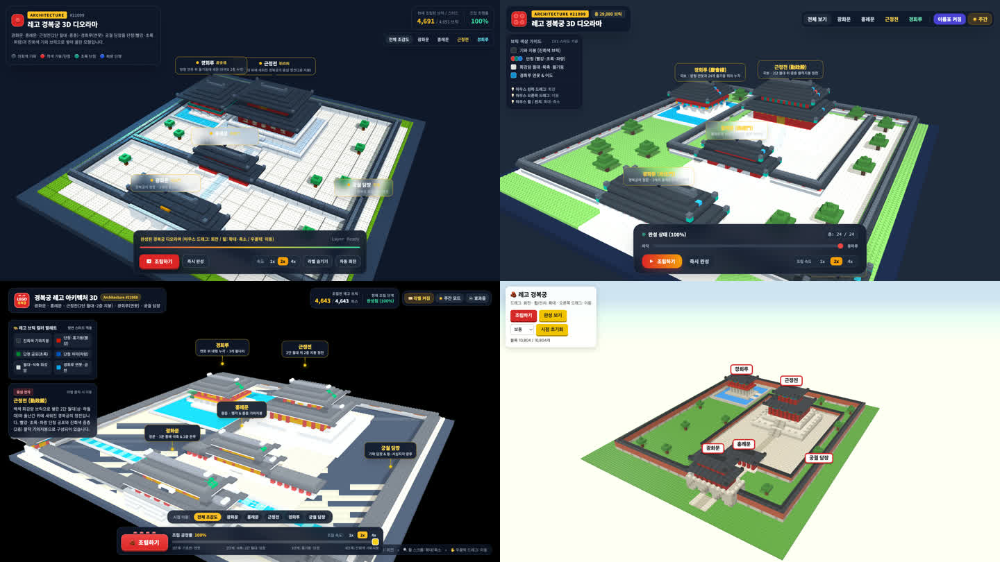

# 경복궁 레고 프롬프트 — 사고 수준별 비교 (Gemini 4 Argon 3번 + Opus 5.5 1번)

같은 프롬프트(`prompt.txt`)를 2026-10-14에 한 번씩 돌린 결과 HTML이에요. 생성된 파일을 그대로 두었어요.

| 결과 페이지 (바로 열기) | 모델 · 설정 | 걸린 시간 | 블록 수(화면 표시) | 눈에 띈 점 |
|---|---|---|---|---|
| [gemini-low.html](https://conanssam.com/gemini4-argon-demo/gyeongbokgung/gemini-low.html) | Gemini 앱 · 4 Argon · 사고 수준 **최저가** · Canvas | 약 189초 (녹화 기준 ±2초) | 4,691 | 이름표, 26층 조립, 속도 1x·2x·4x, 자동 회전 |
| [gemini-mid.html](https://conanssam.com/gemini4-argon-demo/gyeongbokgung/gemini-mid.html) | Gemini 앱 · 4 Argon · **보통** · Canvas | 173.2초 | 29,080 | 나무, 층 슬라이더, 주간·야간 전환. 흥례문·근정전 이름표가 겹침 |
| [gemini-high.html](https://conanssam.com/gemini4-argon-demo/gyeongbokgung/gemini-high.html) | Gemini 앱 · 4 Argon · **최고가** · Canvas | 351.0초 | 4,643 | 공정 단계 표시, 건물별 시점 이동 + 설명 카드, 효과음 |
| [opus.html](https://conanssam.com/gemini4-argon-demo/gyeongbokgung/opus.html) | claude.ai · Opus 5.5 · 노력 **중간(추천)** · 아티팩트 | 385.5초 | 10,804 | 블록이 실제로 하나씩 쌓임, 완성 보기, 시점 초기화 |

- 시간은 브라우저에서 보낸 순간부터 응답이 끝날 때까지(네트워크·화면 포함)예요. 최저가만 녹화 영상에서 버튼 전환으로 쟀고, 나머지는 페이지에서 중지 버튼이 사라진 시각으로 쟀어요.
- **각각 한 번 돌린 결과**예요. 같은 프롬프트도 돌릴 때마다 결과가 달라져요.
- 이번 결과에선 사고 수준을 올린다고 블록이 많아지지 않았어요. 최고가는 개수 대신 설명·시점 이동 같은 완성도에 시간을 썼어요.
- Gemini 결과는 Three.js r128·Tailwind CDN, Opus 결과는 Three.js 0.160 ES 모듈 CDN을 불러와요. 인터넷이 있어야 열려요.
- 결과 HTML은 각 모델이 만든 파일을 그대로 둔 예시예요(이 저장소의 MIT 라이선스는 `argon.py`에만 해당).
